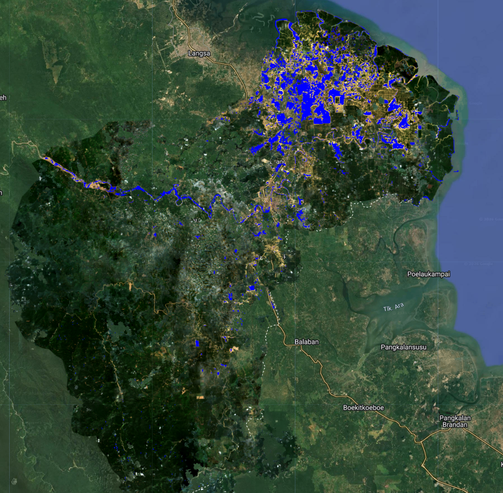

## Ringkasan Proyek
Salah satu wilayah yang terdampak bencana banjir secara signifikan di Provinsi Aceh adalah wilayah Aceh Tamiang yang menimbulkan kerugian material dan non-material. Jumlah korban meninggal di Aceh Tamiang sejumlah 57 orang dari seluruh penduduk di wilayah tersebut. Tujuan proyek untuk mengidentifikasi area terdampak banjir pada wilayah Aceh Tamiang pada Bulan November-Desember 2025. Metode yang digunakan untuk identifikasi wilayah banjir adalah metode SAR (Syntethic Aperture Radar) dengan perpaduan batasan nilai pada polarisasi vertikal-vertikal dan polarisasi vertikal-horizontal. Keunggulan metode SAR salah satunya yaitu minim terdistraksi cuaca sehingga mampu menyajikan data yang lebih representatif dari citra satelit optik. Berdasarkan hasil analisis proyek, luas daerah terdampak banjir sekitar 13295,86 ha dengan wilayah yang sangat terdampak di sekitar wilayah administrasi Sampaimah hasil daripada luapan banjir di daerah aliran sungai Batang Ara.

## Hasil Proyek
